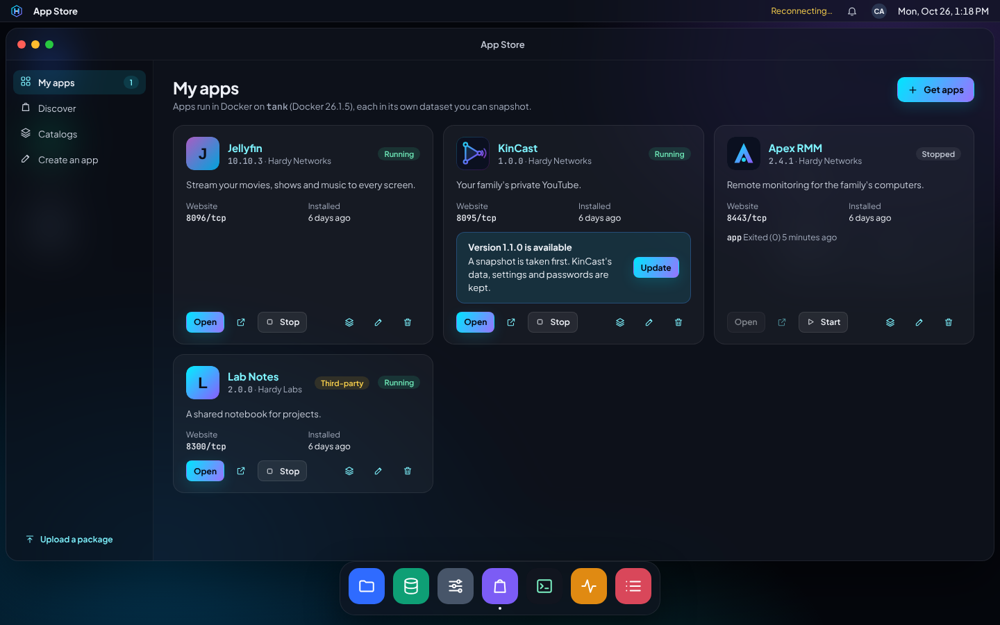
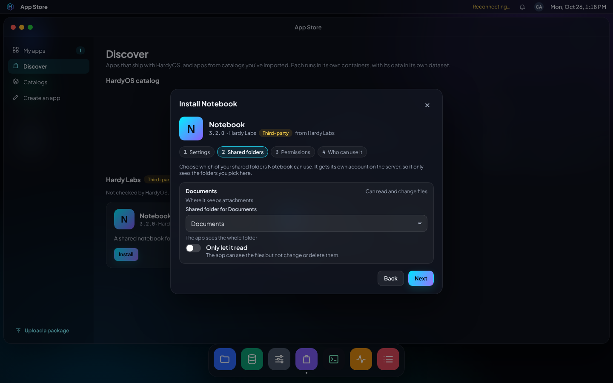
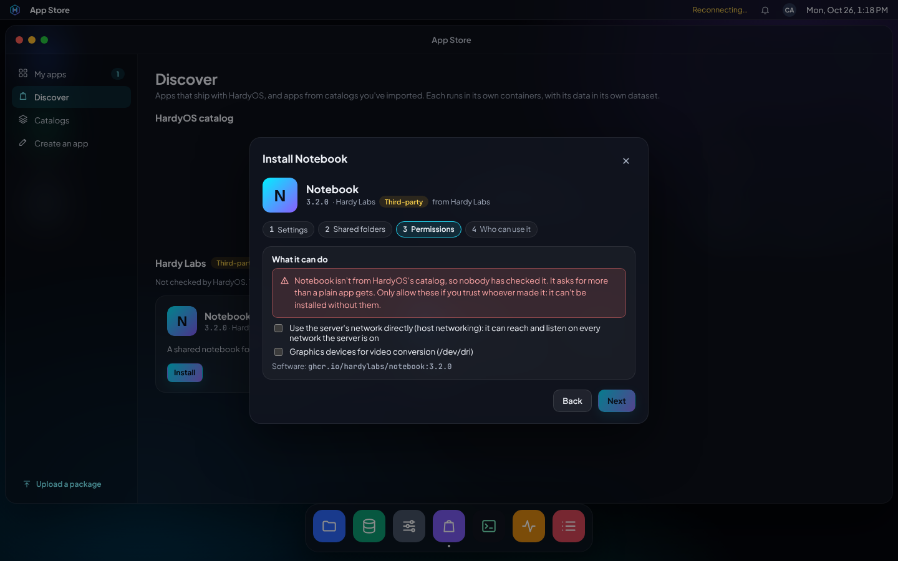
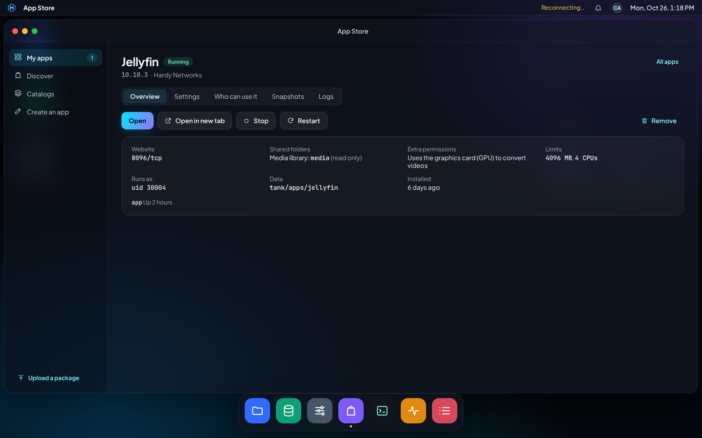
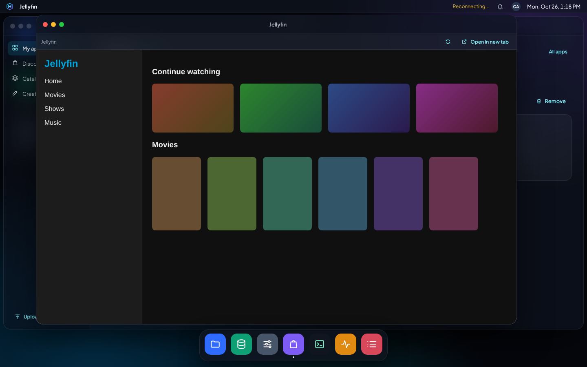

# One-click apps (.hardyapp)

HardyOS installs Docker apps from `.hardyapp` packages: a small file that
describes an app and how to run it. Apps that ship with HardyOS are in the
App Store's **Discover** section; anyone with an administrator account can
also upload a package (App Store › Upload a package).

## What's in a package

A `.hardyapp` is a gzipped tar with these files at the top level:

| File | Required | What it is |
| --- | --- | --- |
| `hardyapp.json` | yes | The manifest: name, version, ports, settings, folders, permissions |
| `compose.yaml` | yes | A Docker Compose file using the variables HardyOS provides |
| `icon.svg` or `icon.png` | yes | The icon named in the manifest (at most 128 KB) |
| `README.md`, `LICENSE` | no | Kept with the package, not used |

Limits: 512 KB compressed, 2 MB unpacked, regular files only.

Build one with `hardyctl app-pack <folder>` (or `make build-apps` for the
catalog in `apps/catalog/`) and check it with `hardyctl app-check`.

## The manifest

```json
{
  "format": 1,
  "id": "kincast",
  "name": "KinCast",
  "version": "1.0.0",
  "summary": "Your family's private YouTube.",
  "description": "Longer text for the install dialog.",
  "publisher": "Hardy Networks",
  "website": "https://github.com/hardynetworks/kintube",
  "icon": "icon.svg",
  "arch": ["amd64", "arm64"],
  "minMemoryMB": 2048,
  "web": { "port": "WEB", "path": "/", "scheme": "http" },
  "ports": [
    { "name": "WEB", "label": "Website", "default": 8095 },
    { "name": "RTMP", "label": "Live streaming", "default": 1935, "protocol": "tcp" }
  ],
  "settings": [
    { "env": "SESSION_SECRET", "generate": "secret" },
    { "env": "MAX_UPLOAD_GB", "label": "Largest upload (GB)", "type": "number", "default": "20", "required": true },
    { "env": "X264_PRESET", "label": "Processing speed", "type": "select", "options": ["veryfast", "fast"], "default": "veryfast" }
  ],
  "folders": [
    { "path": "postgres", "mode": "0700" },
    { "path": "media", "owner": "1000:1000", "mode": "0755" }
  ],
  "shares": [
    { "name": "MEDIA", "label": "Media library", "help": "Where your movies and shows are",
      "access": "read", "suggest": "media", "required": false }
  ],
  "permissions": { "capabilities": [], "devices": [], "hostNetwork": false, "gpu": false }
}
```

- **id**: 2–32 lowercase letters, digits and dashes. It names the app's
  dataset (`<pool>/apps/<id>`) and Compose project (`hardyos-<id>`).
- **version**: compared number by number (`1.10.0` is newer than `1.9.2`); a
  catalog version newer than the installed one shows as an update.
- **ports**: every host port the app publishes, 1024–65535. The install
  dialog offers the default, or the next free port if it's taken. The
  compose file must publish exactly these, through `${HARDY_PORT_<NAME>}`.
- **web**: which port is the app's web page, for the **Open** button.
- **settings**: become environment variables for the compose file. Types are
  `text`, `number`, `boolean` (`"true"`/`"false"`), `select` and `password`.
  `"generate": "secret"` makes a random 64-character password at the first
  install and keeps it across updates and reinstalls; it's never shown.
  Values can't contain single quotes or line breaks. Names starting with `HARDY_`
  belong to HardyOS.
- **folders**: created under the data folder before the app starts, with
  the owner (`uid:gid`) and mode the containers need. Without an owner, a
  folder HardyOS creates belongs to the app's own user (`HARDY_UID`); an
  update never changes the owner of a folder that's already there.
- **shares**: shared folders the app can be given. `name` (`MEDIA`,
  capital letters, digits and `_`) becomes `${HARDY_SHARE_MEDIA}`, which
  the compose file binds. The install dialog offers every shared folder,
  plus an optional subfolder; `suggest` preselects a shared folder by id.
  `access` (`read` or `write`) is the most the app gets: an admin may give
  read where the app asks for write, never the reverse. `required` shares
  must be chosen; any other share left out points at an empty folder of the
  app's own, `${HARDY_APP_DATA}/.unshared/<NAME>`. At most 8.
- **permissions**: what the app needs beyond a plain container, shown to the
  person installing it in plain words.
  - `capabilities` and `devices`: only the allowlist in
    `daemon/internal/apps/policy.go`, for example `NET_ADMIN`,
    `/dev/net/tun`, `/dev/dri` and USB serial sticks. Never `SYS_ADMIN` or
    similar.
  - `hostNetwork`: services may use `network_mode: host`. The app's ports
    are then fixed at their defaults (HardyOS can't move them) and must be
    free; such apps may also use ports below 1024 (DNS on 53).
  - `gpu`: services may use the graphics devices (`/dev/dri`,
    `/dev/dri/renderD*`) and NVIDIA reservations
    (`deploy.resources.reservations.devices` with `driver: nvidia` and
    `capabilities: [gpu]`). HardyOS looks for the hardware when installing:
    without render nodes the devices are dropped, without `/dev/nvidia0` and
    the NVIDIA container toolkit the reservation is dropped, each with a
    warning; an app never fails to install for lack of a GPU. Services given
    a graphics device also join the group that owns it, so an app running as
    its own user can open it.

## Variables HardyOS provides

| Variable | Value |
| --- | --- |
| `HARDY_APP_ID` | The app's id |
| `HARDY_APP_DATA` | The app's data folder: put every bind mount under it |
| `HARDY_HOST` | The server's name or address as the installer reached it |
| `HARDY_TZ` | The server's time zone |
| `HARDY_PORT_<NAME>` | The host port chosen for each manifest port |
| `HARDY_UID`, `HARDY_GID` | The app's own user and group ID (the same number), from 30000-30999 |
| `HARDY_SHARE_<NAME>` | The host folder chosen for each manifest share (or its empty stand-in) |

Each app gets its own user ID at its first install: the lowest free one
from 30000-30999. It's kept in the app's state and stays reserved while the
app's data is kept, so a reinstall finds its files owned by the same ID.
Catalog apps run their processes as it (`PUID`/`PGID`, or
`user: "${HARDY_UID}:${HARDY_GID}"`), and shared folders are given to that
ID.

## What the compose file may do

HardyOS runs `docker compose config` and checks the result (with includes,
`extends` and env files already applied), so what's checked is exactly what
runs. Anything not allowed is refused:

- No `privileged`, no `pid`, `ipc`, `uts` or `cgroup` set to `host`, no
  joining containers or networks outside the app. `network_mode: host` only
  with the `hostNetwork` permission.
- Bind mounts only inside `${HARDY_APP_DATA}` or inside the folder chosen
  for one of the manifest's shares, with private propagation. A bind inside
  a share the app was given read access to is made `read_only`. No named
  volumes (data goes in folders HardyOS can snapshot); anonymous volumes and
  tmpfs are fine.
- Published ports only as declared in the manifest.
- Capabilities and devices only as declared in the manifest's permissions
  (graphics devices and NVIDIA reservations with `gpu`).
- `security_opt` only `no-new-privileges`; sysctls only `net.*`; logging
  only `json-file`, `local`, `journald` or `none`; bridge networks only.
- No `build`, `container_name`, `cgroup_parent`, `gpus`, `secrets`,
  `configs` or privileged lifecycle hooks.

HardyOS sets `restart: unless-stopped` (unless the app chose another policy),
the labels `org.hardyos.app` and `org.hardyos.app.version` and, after the
check, `cgroup_parent` (the app's slice, see Limits) on every container.
Before every start it resolves each bind mount's real path and each shared
folder again: a container can't swap a folder for a link to somewhere else,
a share that moved or went away isn't mounted from its old place, and a
read-only share must still be mounted read-only.

## Sources and grants

Every app records where its package came from: `catalog` (shipped with
HardyOS), `upload` (an admin uploaded a `.hardyapp`), `imported` (from an
imported catalog, whose name is kept as `sourceName`) or `custom` (built
from a pasted Compose file). An update keeps the source unless it's given
again.

Catalog apps get what their manifest declares. Every other app is
sandboxed: each of these needs an admin's grant, by name, in the install
(or settings) request, or the install is refused:

| Manifest asks for | Grant |
| --- | --- |
| `hostNetwork` | `hostNetwork` |
| `gpu` | `gpu` |
| a device, e.g. `/dev/net/tun` | `device:/dev/net/tun` |
| a capability outside Docker's default set, e.g. `NET_ADMIN` | `cap:NET_ADMIN` |

Capabilities already in Docker's default set (`CHOWN`, `NET_RAW`,
`SETUID`, ...) need no grant. Grants are stored with the app and shown on it
(`grants`), only the ones its manifest uses; an update that asks for
something new is refused until that is granted too. hardyd only forwards
grants an admin ticked, and audits them.

## Limits

An app can be given a memory limit (MB) and a processor limit (number of
processors, e.g. `1.5`); 0 means none. They apply to all the app's
containers together through a systemd slice, `hardyos-app-<id>.slice`
(dashes in the id escaped as `\x2d`), written to `/run/systemd/system` with
`MemoryMax` and `CPUQuota` at every start (and at boot, before Docker
brings the containers back), followed by `systemctl daemon-reload`.

## Settings after installing

`apps.reconfigure` changes ports, settings, shared folders, grants and
limits of an installed app using its installed package; the job then runs
`apps.up`. Anything left out keeps its value, and a password setting left
empty keeps its password. Changing the shared folders removes the app's old
access before giving the new one. `apps.config` returns the current
configuration for the settings screen: passwords come back empty with
`set: true`, generated secrets not at all.

## Where things live

The first install asks which pool apps go on. HardyOS then creates:

- `<pool>/docker`: Docker's data (images and containers), not
  auto-snapshotted. Docker is off at boot and started by `hardyd-priv` once
  the pool is mounted, so boot environments never hold app data.
- `<pool>/apps/<id>`: one dataset per app. `data/` is `HARDY_APP_DATA`;
  `.hardyos/` (root only) holds the manifest, compose file, the resolved
  and checked compose file that actually runs, `app.env` with the settings
  and passwords, and `state.json`.

Removing an app keeps its dataset unless "Also delete its data" is ticked.
Installing it again picks the data, passwords and user ID back up (its
shared folders and grants are chosen again). Either way the app loses its
shared folder access and its slice.

## Updates and rollback

Apps update only when an admin clicks Update. The `apps.update` job first
takes `apps.snapshot reason=update`: a ZFS snapshot
`<pool>/apps/<id>@hardyos-update-<yyyymmdd-hhmmss>` (UTC) with the app's
version in the user property `org.hardyos:app-version`, after noting in
`.hardyos/images.json` the image each service runs. The newest three
update snapshots are kept. If a later step fails, the job ends with the
snapshot's name so the App Store offers Roll back.

`apps.snapshots` lists an app's snapshots, newest first, with their
versions. `apps.rollback` needs the app's name as confirmation; it stops the
app, runs `zfs rollback -r` (later snapshots go), puts the images back on
their tags if those images are still on the server, gives back the shared
folders the snapshot had, and starts the app with the package, settings and
limits inside the snapshot.

## How installing works

1. `POST /apps/plan`: hardyd reads the package and asks `hardyd-priv` for
   free ports (host-network apps keep their own: `fixed`).
2. `POST /apps/install` starts an `apps.install` job. The request carries
   the package's source, settings, ports, the shared folder for each of the
   app's shares, the extra permissions an administrator ticked (`grants`,
   only for apps not from HardyOS's catalog), resource limits and who may
   use it. Password settings go to the job through an in-memory reference,
   not its parameters. Each grant is audited on its own (`apps.grant`).
3. The job calls `hardyd-priv` to prepare the app (dataset, files, compose
   check), pull each image (retrying; if a registry is unreachable and the
   image is already on the server, that copy is used), and start it.

Every step is a named operation in `hardyd-priv` (`apps.prepare`,
`apps.pull`, `apps.up`, `apps.reconfigure`, `apps.snapshot`,
`apps.rollback`, ...) with checked arguments. There is no way to run
an arbitrary compose file or command.

## The catalog

The apps shipped with HardyOS are in `apps/catalog/<id>/`, with an overview
of each app's shared folders and permissions in
[apps/README.md](../apps/README.md). Media server, photo, home, network,
password, document and download apps: Jellyfin, Plex, Immich, Home
Assistant, AdGuard Home, Vaultwarden, Paperless-ngx, Sonarr, Radarr,
Prowlarr, qBittorrent, Bazarr and Seerr (Jellyseerr), plus KinCast and Apex
RMM.

- Image versions are pinned in each `compose.yaml` and the package version
  follows the app's own version, so **Update** in the App Store is how an
  app moves to a new version (decision 70).
- Media apps see the same folders at the same paths: the Media library at
  `/media`, Downloads at `/downloads` (decision 71). Apps reach each other
  at `host.docker.internal:<port>` or the server's address.
- Only catalog apps get `gpu` (Jellyfin, Plex, Immich) and `hostNetwork`
  (Home Assistant, AdGuard Home) just by declaring them.

## The App Store

**My apps** lists the installed apps. Everyone sees the apps they may use
and can open them; administrators also start, stop, update and remove them,
and open an app's page for its settings:

- **Overview**: Open (in a desktop window) or Open in new tab, start, stop,
  restart, the shared folders, permissions and limits it has. **Update**
  appears when the catalog it came from has a newer version. A snapshot of
  the app is taken first; if the update fails, the App Store offers to roll
  back to it. If the new version asks for a permission the app doesn't
  have (apps not from HardyOS's catalog), it asks you to allow it first.
- **Settings**: ports, settings (passwords stay as they are unless you type
  a new one), shared folders, extra permissions and resource limits. Saving
  restarts the app.
- **Who can use it**: everyone signed in, or chosen HardyOS accounts, domain
  users (`HOME\alice`) and domain groups (`HOME\Family`). Administrators can
  always use every app.
- **Snapshots**: the snapshots taken before updates (the newest three), each
  with the version it holds, and Roll back (type the app's name).
- **Logs**: the last 500 lines from every container.

**Install** walks through steps: settings (ports, settings and, the first
time, the pool), shared folders (one per folder the app asks for; apps get
whole shared folders, read-only if you like), permissions, and who can use
it with resource limits under Advanced. Permissions of apps from HardyOS's
catalog are listed in plain words. For uploaded, imported and custom apps
every extra permission is an unticked box under a red warning, and the app
can't be installed until each is ticked.

**Discover** shows HardyOS's catalog and, under each imported catalog's
name, its apps labelled **Third-party**.

**Catalogs** imports someone else's catalog from an https address,
refreshes it and removes it. A catalog is an `index.json`:

```json
{
  "name": "Hardy Labs",
  "apps": [
    { "id": "notebook", "name": "Notebook", "version": "3.2.0", "summary": "Shared notes.",
      "url": "packages/notebook-3.2.0.hardyapp",
      "sha256": "9f2c…64 hex digits…", "icon": "data:image/svg+xml;base64,…" }
  ]
}
```

`url` may be relative to the index and must be https. hardyd downloads a
package when it's first planned and uses it only if its SHA-256 matches and
it is the app and version the index names. Apps with problems in the index
are left out (the Catalogs page says which). Icons are only taken as data:
URLs. Removing a catalog keeps its apps running; they just get no more
updates from it.

**Create an app** turns a pasted Compose file into a custom app: a name,
an id, the ports it publishes (one may be its web page) and data folders.
The Compose file publishes each port as `${HARDY_PORT_<NAME>}` and keeps
its data under `${HARDY_APP_DATA}`; the same sandbox as uploaded packages
applies. hardyd builds a `.hardyapp` (source `custom`) and the normal
install follows. To change it later, create it again with a higher version
and update the app with that package.

**Upload a package** installs a `.hardyapp` file (source `upload`).

## App windows

Apps open as desktop windows. The desktop is served over HTTPS, so hardyd
runs a small HTTPS proxy for each app with a web page on its own port
(44300, 44301, …, remembered per app) with the desktop's certificate. Each
Open asks hardyd for a one-minute, single-use link; the proxy swaps it for
a cookie for that app only, and the session ends when you sign out of the
desktop or lose access to the app. The proxy passes WebSockets, lets the
desktop frame the app, and never forwards HardyOS's own cookies. **Open in
new tab** uses the same proxy.

## API

| Call | Who | What |
| --- | --- | --- |
| `GET /apps` | signed in | Installed apps (only those you may use, for non-admins) |
| `GET /apps/catalog` | admin | HardyOS's catalog |
| `GET/POST/DELETE /apps/catalogs` | admin | Imported catalogs: list, import or refresh (`{url}`), remove (`{id}`) |
| `POST /apps/packages` | admin | Upload a package |
| `POST /apps/custom` | admin | Build a custom app; answers with an install plan |
| `POST /apps/plan`, `POST /apps/install` | admin | Plan and install (job `apps.install`) |
| `GET/PATCH /apps/{id}/config` | admin | Current configuration; change it (job `apps.reconfigure`) |
| `GET/PUT /apps/{id}/access` | admin | Who may use the app |
| `POST /apps/{id}/update` | admin | Update (job `apps.update`, snapshot first); `grants_required` when new permissions need allowing |
| `GET /apps/{id}/snapshots`, `POST /apps/{id}/rollback` | admin | Snapshots and roll back (job, confirm = the app's name) |
| `POST /apps/{id}/open` | who may use it | A link to open the app (through its window proxy) |
| `POST /apps/{id}/start\|stop\|restart`, `GET /apps/{id}/logs`, `DELETE /apps/{id}` | admin | As before |

Who may use each app, imported catalogs and window ports are kept in
hardyd's database, so settings backups include them; each app's own
configuration is on its dataset.

## Screens






