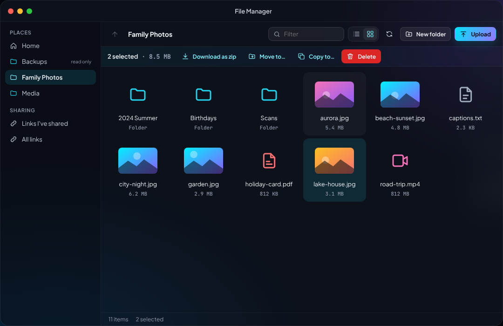
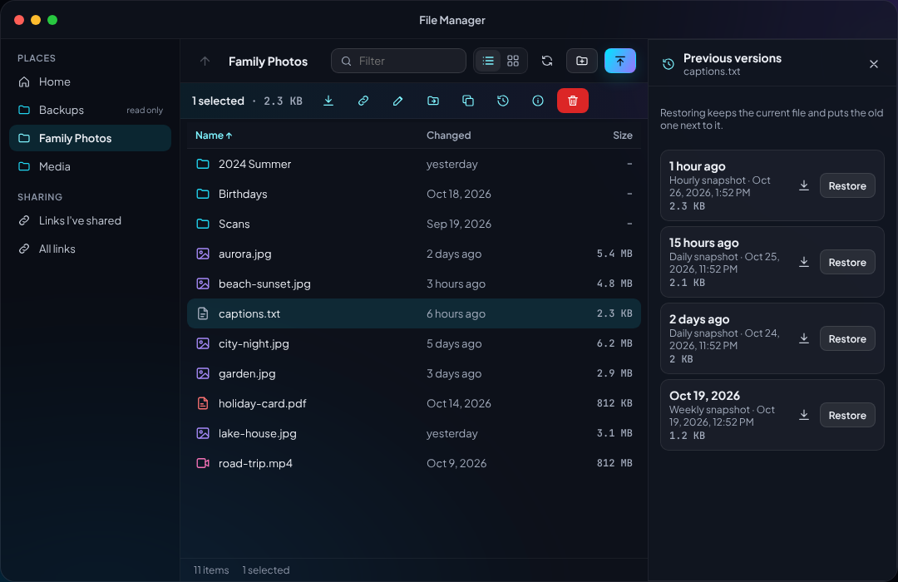
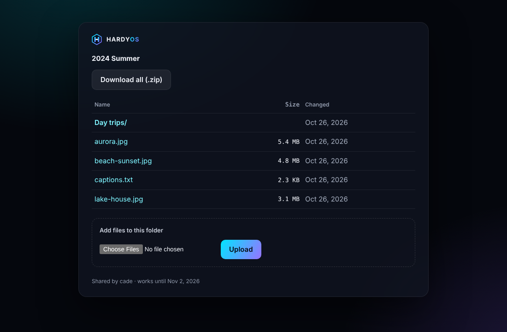
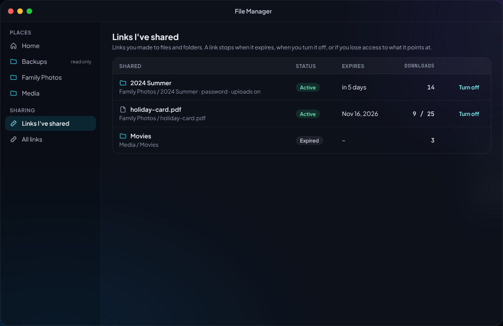

# File sharing (Windows, Mac, Linux, Time Machine)

The shared folders (Control Panel › **Shared Folders**, see
[shares.md](shares.md)) can be opened from the family's computers over SMB,
the protocol Windows and macOS use natively. People sign in with their
**domain account** (Control Panel › Domain), and each folder's "Who can use
it" rules decide what they can do.

## Setting it up

Control Panel › **File Services**.

- **This server runs the domain.** Nothing to do: creating the domain (or
  making this server another domain controller) also connects the file
  server to it. If that step failed, File Services shows **Join the
  domain**: enter the domain Administrator's password.
- **The domain runs elsewhere** (another HardyOS server, or Windows
  Server). Point this server's DNS at the domain's DNS servers (Control
  Panel › Network), then in File Services enter the domain's name (like
  `home.yourname.net`), an administrator account and its password.
- The password is used once to add the server to the domain and isn't
  kept.
- **SMB sharing** turns sharing on or off for the whole server. Each
  shared folder has its own switch too (Shared Folders › Edit ›
  *Windows and Mac file sharing*), on for new folders.
- **Leave the domain** stops sharing. With the Administrator password the
  server's computer account is removed from the domain as well; without
  it the server just forgets the domain. Files and their permissions stay.

The server's name on the network is its host name in capitals
(`HARDYOS`), shown at the top of File Services.

## Who can do what

The rules you set on a shared folder apply over SMB and on disk:

| Rule | Over SMB |
| --- | --- |
| Everyone | every domain account (`HOME\Domain Users`) |
| A group (`HOME\Family`) | its members |
| A person (`HOME\alice`) | that account |
| Read only | open and copy files |
| Read and write | also create, change and delete |
| No access | can't open the folder at all, whatever else applies |

- **Administrators** (Domain Admins, and the HardyOS Admins group) can
  always read and write every shared folder.
- No rules means administrators only.
- A person's own rule wins over their groups' rules on disk: if Everyone
  may write but alice is set to read only, alice can open the folder but
  not change it.
- Rules naming a HardyOS account (not a domain one) don't apply over SMB;
  File Services points them out.
- **Guest access** lets people on the network open the folder read-only
  without signing in (guest connections are `nobody`).

## Connecting

Replace `HARDYOS` with your server's name and `Media` with the folder's
name. File Services lists the exact addresses for every folder.

### Windows

- File Explorer › address bar: `\\HARDYOS\Media`, or right-click
  **This PC › Map network drive**, pick a letter, enter
  `\\HARDYOS\Media` and tick *Reconnect at sign-in*.
- PCs joined to the domain sign in by themselves. Others ask: use
  `HOME\yourname` and your domain password.
- **Previous Versions**: right-click a file or folder › Properties ›
  Previous Versions lists the folder's automatic snapshots; open, copy
  or restore an older copy from there.

### Mac

- Finder › **Go › Connect to Server** (⌘K): `smb://hardyos.home.yourname.net/Media`
  (or `smb://<the server's address>/Media`). The server also shows under
  **Network** in Finder's sidebar.
- Sign in as **Registered User** with `yourname` and your domain password
  (domain: `HOME` if asked). Tick *Remember this password in my keychain*.

### Time Machine (Mac backups)

1. In Shared Folders, edit a folder (Backups is a good one), turn on
   **Time Machine** and optionally set the most each Mac may use. Give the
   folder a quota too, so backups can't fill the pool.
2. On the Mac: System Settings › General › **Time Machine** › Add Backup
   Disk, and pick the folder on your server (it's advertised on the
   network). Sign in with a domain account that may write to it.

Time Machine folders have no recycle bin (Time Machine deletes old backups
itself).

### Linux

- File managers (GNOME Files, Dolphin): `smb://hardyos.home.yourname.net/Media`.
- Terminal, with `cifs-utils` installed:

  ```
  sudo mkdir -p /mnt/media
  sudo mount -t cifs //hardyos.home.yourname.net/Media /mnt/media \
    -o username=yourname,domain=HOME,uid=$(id -u),gid=$(id -g)
  ```

  For Linux machines that should mount by address only, NFS is available
  per folder too (Shared Folders › Edit › NFS).

## Recycle bin

With a folder's **Recycle bin** on, files deleted over SMB or in the File
Manager go to a hidden `.recycle` folder inside it, into the bin of the
person who deleted them, with their folders kept. Each bin is named after
the domain and the account (`home.alice`; `hardyos-files` for HardyOS
administrators in the File Manager) and only its owner can open it. Open
`\\HARDYOS\Media\.recycle\home.alice` to get something back (type the
address; it's hidden). Files that have been there for 30 days are removed
automatically. If someone else made a folder with your bin's name, HardyOS
moves it aside within ten minutes; until then deleting in the File
Manager says your bin can't be used safely (delete permanently instead).

## Home folders

File Services › **Home folders** gives every domain account its own
private folder on the pool you choose, with an optional quota. It appears
as the person's name on the network (`\\HARDYOS\alice`) and as **Home** in
the File Manager. Folders are made for new accounts within ten minutes;
turned-off or deleted accounts keep their folder (an administrator can
delete it).

## SFTP and WebDAV (from anywhere)

Two more ways in for domain accounts, handy away from home (over the
NetBird VPN) and for apps: **SFTP** (over SSH) and **WebDAV** (over
HTTPS). Both are off until an administrator turns them on in Control
Panel › **File Services** › *SFTP and WebDAV*, and each shared folder has
its own two switches (Shared Folders › Edit › *SFTP and WebDAV*, off for
new folders). People always sign in with their domain account
(`HOME\alice` and their domain password) and see only the folders with
that service on that their rules let them use, plus their **Home** folder
when home folders are on. What they can do inside is decided by the
folder's rules and the permissions on disk, exactly as over SMB.

HardyOS accounts (like the administrator you set the server up with)
don't use SFTP or WebDAV: they're for the family's domain accounts.

### SFTP

Server: the server's name (`hardyos.home.example.net`) or address, port
22, user `HOME\alice`, the domain password.

- **Windows**: WinSCP or FileZilla, protocol SFTP. Or in PowerShell:
  `sftp 'HOME\alice@hardyos.home.example.net'`.
- **Mac**: Cyberduck or Transmit (SFTP), or in Terminal
  `sftp 'HOME\alice@hardyos.home.example.net'`.
- **Linux**: file managers open
  `sftp://HOME%5Calice@hardyos.home.example.net/`; from a terminal
  `sftp 'HOME\alice@hardyos.home.example.net'`;
  `sshfs 'HOME\alice@hardyos.home.example.net:/Media' ~/media` mounts a
  folder; `rclone` with an `sftp` remote works too.
- After signing in you're at the top of your own view: one folder per
  shared folder you may use, and `Home`. Folders you may only read are
  read only. Nothing else on the server is reachable.

Limits: SFTP accounts can't open a shell, run commands, or forward ports
(no tunnels); only the password works (SSH keys aren't used, so changing
your domain password or turning the account off always locks it out).
A new account, a new rule or a new folder shows up within 10 minutes;
an account with no folder to see can't sign in. Folders don't hide
`.recycle` or `.zfs` over SFTP, but their permissions still apply (your
own recycle bin, older versions read only). The server's own SSH for its
Linux accounts (root with a key, as before) is unchanged.

### WebDAV

Address: `https://<the server>/dav/` (the same address as the web
desktop, with `/dav/`), user `HOME\alice`, the domain password.

- **Windows**: File Explorer › This PC › *Map network drive*, folder
  `\\hardyos.home.example.net@SSL\dav` (or
  `https://hardyos.home.example.net/dav/`), tick *Connect using different
  credentials*. Windows only connects when it trusts the server's HTTPS
  certificate: until the server has a real certificate, import its
  certificate into *Trusted Root Certification Authorities* (open the web
  desktop in Edge, View certificate › Export, then double-click the file).
  Windows limits single files to 50 MB unless the `FileSizeLimitInBytes`
  setting of its WebClient service is raised.
- **Mac**: Finder › Go › *Connect to Server* › `https://hardyos.home.example.net/dav/`.
  Finder writes `._name` and `.DS_Store` files next to yours.
- **Linux**: file managers open `davs://hardyos.home.example.net/dav/`;
  `davfs2` mounts it.
- **rclone** (any system):
  ```sh
  rclone config create hardyos webdav url=https://hardyos.home.example.net/dav/ vendor=other \
    user='HOME\alice' pass="$(rclone obscure 'your password')"
  rclone ls hardyos:Media
  ```
  (add `--no-check-certificate` while the server has its own certificate).

Limits: the password is checked like a desktop sign-in (five wrong ones
in 15 minutes lock the account and the address out of WebDAV and the
desktop for 15 minutes); a password that worked is remembered for two
minutes, so a password changed in the domain may still work that long.
WebDAV only works over HTTPS, and (like desktop sign-in with domain accounts) only on the server that runs the domain controller itself. Uploads go into place only once they're
complete. Deleting goes to the folder's recycle bin. File properties
apps try to store (WebDAV "dead properties") aren't kept, except the
modification time Windows sets. Older versions aren't offered over
WebDAV (use Previous Versions over SMB or the File Manager). Copying on
the server (WebDAV COPY) streams through hardyd, so it's slower than a
copy in the File Manager.

## How it works (for administrators)

- The server runs its own Samba file server (`smbd` and `winbind`) as a
  member of the domain, separate from the domain controller's Samba.
  HardyOS writes `/etc/samba/smb.conf` itself: changes made by hand are
  replaced.
- Domain accounts get the same Linux user and group IDs on every HardyOS
  server (100000 + their RID), so file ownership survives moving a pool.
- Permissions are POSIX ACLs on the folders, set by HardyOS from the
  rules. Changing permissions from Windows' Security tab works for files
  you own, but HardyOS sets the folder's top again from its rules.
- Logs: in the Terminal, `journalctl -u smbd -u winbind` and
  `/var/log/samba/`.

## File Manager

The **File Manager** app (in the dock and on the desktop) opens the shared
folders you may use, plus your own **Home** folder, in the web desktop.
Everything you do happens as you: you see and change only what your access
allows, exactly as over the network.



### Finding your way

- **Places** on the left: Home, then the shared folders you can use
  (marked *read only* where you can only look). Hidden system folders such
  as the recycle bin and snapshots never show.
- **Breadcrumbs** at the top take you back to any folder on the way; the up
  arrow (or **Backspace**) goes up one.
- **List** or **grid** view (the switch at the top right; grid shows photo
  thumbnails). Click a column heading in the list to sort by name, date or
  size; click it again to reverse. Folders always come first. The File
  Manager remembers your choice.
- **Filter** narrows the current folder to names containing what you type.
- On a phone or in a narrow window the places become a strip along the
  top and the buttons shrink to icons.

### Selecting and the keyboard

- Click to select, **Ctrl/Cmd+click** to add or remove one, **Shift+click**
  to select a range. **Ctrl/Cmd+A** selects everything, **Esc** clears.
- **Arrow keys** move (with Shift they extend the selection), **Enter**
  opens a folder or previews a file, **Space** previews, **Backspace** goes
  up, **Delete** deletes, **F2** renames.
- **Right-click** an item for everything you can do with it; right-click
  empty space for New folder and Upload.

### Working with files

- **Upload**: drag files from your computer onto the window, or use
  **Upload**. Files go up in pieces with a progress bar each; the cross
  cancels one. Nothing is ever replaced: a name that's taken gets " (2)".
  Dragging a whole folder isn't supported yet; make the folder and drop its
  files in.
- **Download** a file, or select folders or several items and get them as
  one zip.
- **New folder**, **Rename** (F2), **Move to…** and **Copy to…** (pick any
  folder you can change, in any shared folder or Home), **Properties**.
- **Delete** says what will happen: in a folder with a recycle bin, items
  go there and are kept for 30 days (an administrator can get them back);
  without one they are gone for good unless a snapshot still has them.
- **Quick preview** (Enter, Space or double-click): photos, PDFs, text
  files (the first 256 KB), video and music. The arrows (or ← →) step
  through the folder; Esc closes.

### Previous versions

Select a file or folder and choose **Previous versions**. The panel lists
the older copies kept by the folder's automatic snapshots (hourly, daily,
weekly, monthly). **Download** saves that old copy; **Restore** puts it
back next to the current one (named "… (restored <date>)" when the name is
taken), so restoring never loses anything.



### Share links

Select one file or folder and choose **Share link** to give it to someone
without an account. You can share what you're allowed to change;
administrators can share anything.

- **Works for** 1, 7 (the default), 30 or 90 days.
- **Password** (at least 6 characters): tell it to people some other way.
- **Let people add files** (folders only): visitors can upload into the
  folder, never change or delete anything. Their files never replace
  yours. **Upload limit** is how much the link takes in, in all (1 GB to
  1 TB, 10 GB unless you choose otherwise); one file can be up to 5 GB.
  Names starting with a dot (like `.htaccess`) aren't accepted, and a file
  that fails or doesn't fit is deleted at once, not kept in the recycle
  bin.
- **Download limit**: the link stops after that many downloads. Each file
  downloaded counts once: a download that is resumed, or a video that
  skips ahead, within 6 hours doesn't count again. Every "Download all"
  zip counts.

A folder link's **Download all** makes one zip at a time per link (and
two per visitor), of at most 20 GB (a link made through the API can choose
1 MB to 1 TB). A bigger folder's zip stops there, with a note saying so;
the rest can be downloaded file by file. Names that Windows can't use in a
zip (with `\`, `:` or control characters) get `_` in their place.

The link is shown **once**: copy it then. HardyOS keeps only a fingerprint
of it, so nobody (not even an administrator) can read it back later.

The person opening it gets a simple HardyOS page outside the desktop: the
folder's files (and its subfolders) to download one by one or all as a
zip, or the one file, plus the upload box when allowed.



A link stops working when it expires, when it is turned off, when its
download limit is reached, and also when the person who made it loses
access to what it points at, or their account is disabled or deleted:
files are always read as that person.

**Links I've shared** (under Sharing in the File Manager) lists your links
with their status, expiry and download count; **Turn off** stops one at
once. Administrators also see **All links** and can turn off anyone's.



Links work on your home network now; reaching them from outside comes
with remote access (the reverse proxy). Every link made, used (downloads,
uploads, wrong passwords) and turned off is in the Log Center. Five wrong
passwords lock that visitor out of the link for 15 minutes; others with
the link can still open it (only very many wrong passwords from everywhere
lock the link itself for a while).

**Known limitation: PDF previews.** The File Manager's quick preview shows
PDFs with the browser's own viewer on the desktop's address, without the
sandbox other previews get (browser PDF viewers don't work inside one).
Browsers don't run a PDF's scripts against the page, so this is accepted
for now (decision 104); once remote access (the reverse proxy) lands,
previews move to a separate address. Share link downloads are never shown
inline.

### For developers

- Web: `web/apps/shell/src/apps/files/` (`FileManager.tsx`, dialogs,
  `Uploads.tsx` for the chunked upload queue, `Preview.tsx`,
  `Versions.tsx`, `SharedLinks.tsx`, pure helpers in `paths.ts` and
  `selection.ts`). Tests mock the API with a stubbed `fetch`.
- It consumes the files API (`/api/v1/files/*`, part C of the plan) and the
  share link API (`/api/v1/sharelinks`). Both are in `api/openapi.yaml`.
- Share links: `daemon/internal/sharelinks` (store, public pages,
  rate limiter; `linktest` has a fake `files.Access` over a temp dir) and
  `daemon/internal/api/handlers_sharelinks.go`. Behind a reverse proxy,
  start hardyd with `-trusted-proxies <address or CIDR,...>` so limits and
  the Log Center see visitors' addresses (`X-Forwarded-For` is ignored
  otherwise). See
  [architecture.md](architecture.md#file-manager-and-share-links).
