# Virtual machines

Run whole computers inside your HardyOS server: Windows 10 or 11, a Linux
server, a gaming PC with its own graphics card, Home Assistant, a router
(OPNsense or pfSense), TrueNAS, or anything else from an installer disc or a
disk image. Open **Virtual Machines** in the dock (administrators only).

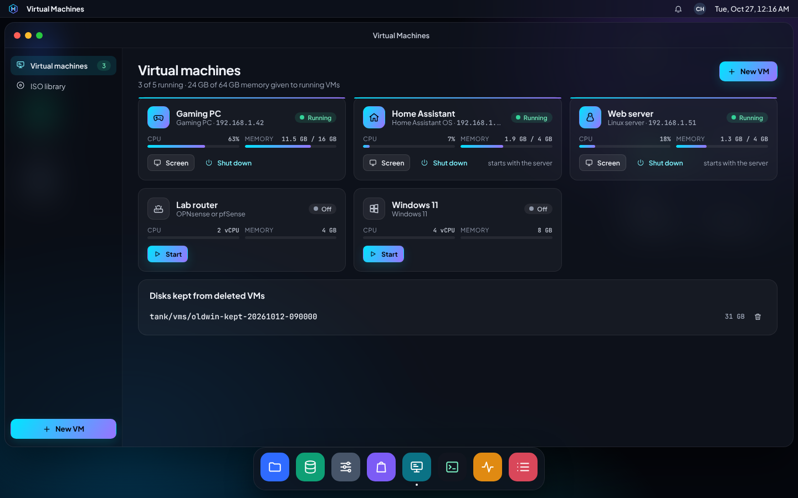

Graphics cards and other devices are covered in [GPUs and devices](gpus.md).
How it works inside: [architecture](architecture.md#virtual-machines),
decisions 120-125, 134-143, 400-409 and 410-419.

## Before you start

- The server's processor must have virtualization turned on (Intel VT-x or
  AMD-V, in the BIOS/UEFI setup). If it's off, the app says so.
- You need a storage pool. VM disks live on the pool you choose; a pool on
  SSDs makes VMs feel much quicker.

## Making a VM

Click **New VM**. Seven short steps, with sensible choices already made:

1. **Template**: what you want to run. Each template sets the right
   firmware, disk and network types, and drivers.

   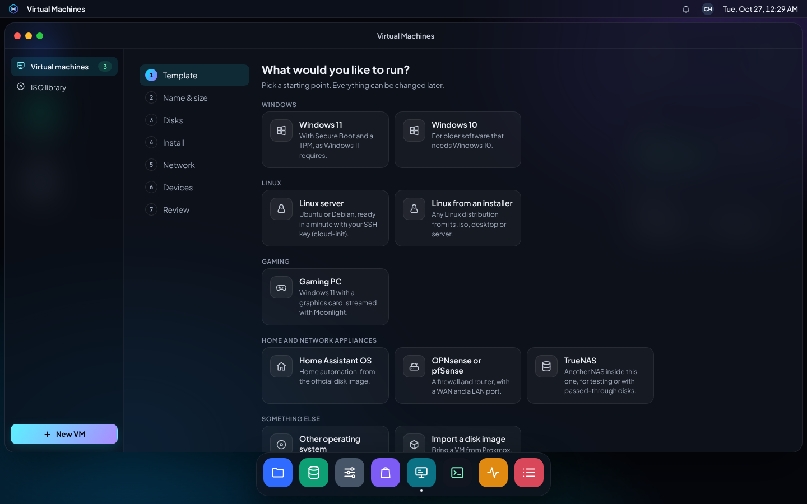

2. **Name & size**: a name, then Light, Standard or Power (or set the CPU
   cores and memory yourself). The app warns when running VMs would want
   more memory than the server has. *Show advanced settings* has firmware
   (UEFI or BIOS), Secure Boot, TPM and threads per core.

   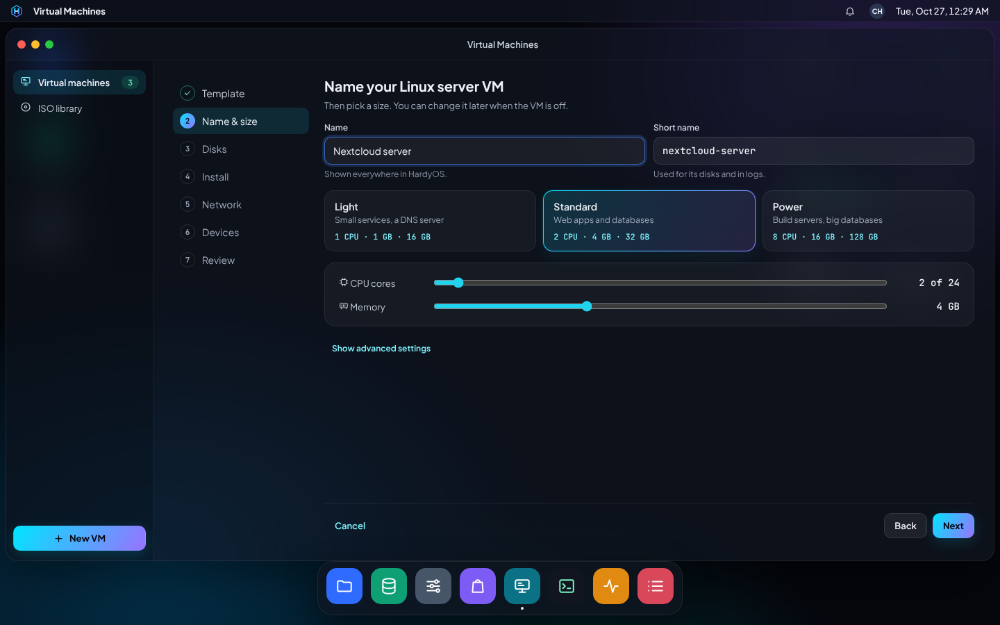

3. **Disks**: the pool, and the disks' sizes. Disks are *thin*: a 96 GB
   disk only takes the space the VM has really written. Add more disks
   here or later. The disks must fit in the pool's free space; turn on
   *Allow more than the pool has free* to make them bigger anyway. Each VM
   can use at most its disks' sizes plus a quarter (and 2 GB) on the pool,
   snapshots included, so one VM can't fill the pool for everything else.
4. **Install**: the installer disc, or for Home Assistant, cloud images and
   imports, the disk image. Pick it from the **ISO library** or paste a
   download link (with its SHA-256 checksum if the download page gives one).
   Linux cloud images ask for a user name and an SSH key and/or a password:
   the VM is ready to sign in to over SSH a minute after it starts.

   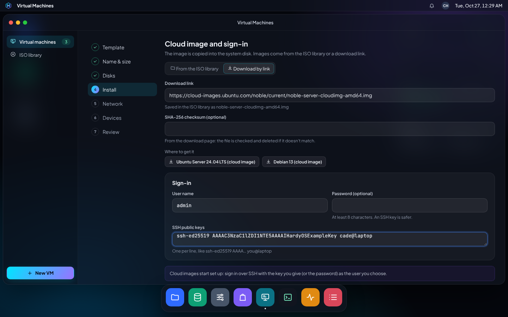

5. **Network**: **Home network** (recommended: the VM gets its own address
   from your router, like any computer), **Private (NAT)** (it reaches the
   internet through the server but nothing can reach it), or a **VLAN**.
   Routers get two network cards (WAN and LAN).

   On the home network and VLANs, a card may only use its own MAC address
   and the IP address it got, so a VM can't pretend to be the router or
   another computer. Routers and firewalls (OPNsense, pfSense) forward
   other computers' traffic and need **Allow address spoofing** on (the
   router template turns it on). Cards with the filter use IPv6 too: their
   link-local address and the addresses they make themselves (SLAAC and
   privacy addresses) in the prefixes your router advertises, but they
   can't act as a router or DHCPv6 server, and can't claim the server's,
   a router's, a DNS server's or another computer's address (one it was
   seen using on your network). Cards on a VLAN the server has no
   interface on get no IPv6 at all, and cards on **Private (NAT)** don't
   either (that network is IPv4). VMs on **Private (NAT)** can reach the internet and
   ask the server for an address and names (DHCP, DNS), but nothing else
   on the server itself (not its web desktop, SSH or shared folders).

   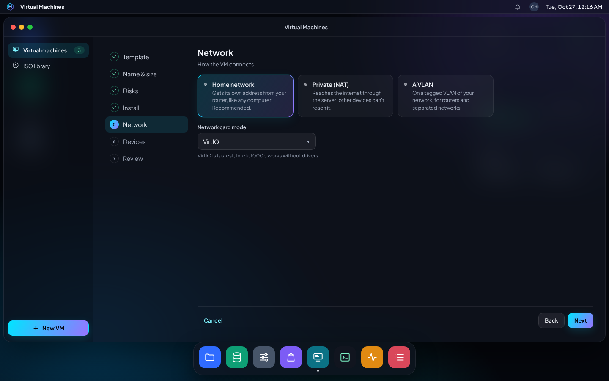

6. **Devices**: a graphics card, USB devices (a Zigbee stick for Home
   Assistant) or other PCI devices; see [GPUs and devices](gpus.md).
7. **Review**: check, choose whether it starts now and whether it starts
   with the server, and **Create VM**. Downloads, the network bridge, the
   drivers disc and copying a disk image all happen in the creation job;
   you can close the window while it runs.

### The first VM on your home network

VMs join your home network through a *bridge* (`br0`), a virtual switch
over the server's network port. The first VM that needs it creates it: the
server's network restarts for a few seconds and keeps its address (the
bridge takes over the port's address and MAC address). HardyOS then checks
that the server still has its address and the router answers; if not, it
puts the old settings back by itself and the VM isn't created (use NAT, or
set up the bridge in Control Panel > Network). If the server runs the
domain controller, it moves onto the bridge too. The bridge shows up in
Control Panel > Network, where its address can be changed or the bridge
removed (VMs on it then lose their network).

### Windows

Get the Windows installer (.iso) from Microsoft's download page and copy it
into the ISOs shared folder (or paste a download link). HardyOS doesn't
handle licences or product keys: Windows installs unactivated and you
activate it with your own licence.

**Install by itself** (on by default for Windows 11, Windows 10, Windows
Server 2025 and the gaming PC): give the account name and password, the
edition as your ISO names it (*Windows 11 Pro*, *Windows Server 2025
Standard (Desktop Experience)*…), the language (en-US) and optionally the
time zone. HardyOS makes a small **Windows setup disc** with an answer file
for Setup, attaches the VirtIO drivers disc, and on the first start
presses the key Windows' installer waits for. Watch it on the VM's screen:
Setup wipes the VM's new disk, loads the VirtIO drivers, installs, makes
your account, signs in once and installs the VirtIO guest tools (network,
display, memory, clipboard and the guest agent).

Until Windows is installed, the VM starts **without the devices you pass
through** (a graphics card, a USB stick, a disk controller) and USB devices
can't be plugged in, so Setup can only ever see, and wipe, the VM's own new
disk. Restart the VM once Windows is installed and they join.

The setup disc holds the account's password. It's kept only in the
server's memory (never on a pool, so it's in no snapshot, replica or cloud
backup), and as soon as Windows is installed and the guest agent answers,
HardyOS takes it out of the VM and deletes it. You can also take it out
yourself on the VM's page. If the server restarts during an install the
disc is gone: finish Windows setup by hand on the VM's screen (take the
disc out in Hardware), or make the VM again.

Without it, install by hand: when Setup shows no disk, click **Load
driver**, open the VirtIO drivers disc and pick the `vioscsi` folder for
your Windows version; after Windows starts run `virtio-win-guest-tools.exe`
from the same disc.

Windows 11 and Server 2025 get Secure Boot, a TPM 2.0 and Hyper-V
enlightenments. If an installer can't see the disk at all, change the disk
type to SATA in **Hardware**.

### Linux servers (cloud images)

**Debian 13** and **Ubuntu Server 24.04** are one click: HardyOS downloads
the official cloud image itself and checks it against its publisher's
checksums (Ubuntu's are also checked against Ubuntu's signing key, and old
signed checksums are refused) before it's used. Verified images (and the
VirtIO drivers disc) are kept in a folder on the pool that only HardyOS can
write, never in the ISOs shared folder, and reused while they're still the
current ones. The ISOs folder doesn't take files of the same names. It's copied into the disk (growing the disk if the
image is bigger) and set up with cloud-init: your user (with sudo), your
SSH keys, the password if you gave one, the host name, and the QEMU guest
agent. Sign in with `ssh <user>@<the VM's address>`; the address shows on
the VM's page once the guest agent runs. The **Linux server** template
takes any other distribution's cloud image by link.

### Your templates

**Settings › Make a template** (the VM must be off) copies a VM's disks and
settings into a template; new VMs start from it in the wizard under **Your
templates**, with their own copies of the disks. The template leaves out
what makes the VM one particular computer: its network addresses, the
cloud-init password, the TPM, passed-through devices and schedules. Before
making one, run **Sysprep** in Windows (`sysprep /generalize /oobe
/shutdown`) or `sudo cloud-init clean` in Linux, so each copy sets itself up
as a new computer. Templates take space on the pool like the disks they
copy; delete them (type the name) when you don't need them.

### Home Assistant, OPNsense, TrueNAS, imports

- **Home Assistant OS**: the official `.qcow2.xz` image is downloaded and
  unpacked into the disk. Home Assistant opens at
  `http://<the VM's address>:8123` a few minutes after the first start.
- **OPNsense / pfSense**: get the DVD image (.iso); the VM has a WAN and a
  LAN card. Put the WAN card on its own VLAN (or pass a network port
  through) so the router sits between the internet and your network.
- **Import a disk image**: VMs from Proxmox, VirtualBox, VMware or Hyper-V
  (qcow2, vmdk, vdi, vhdx, raw). Copy the image into the ISOs folder first.
  Images that need other files (backing files, split VMDKs, VMDK
  descriptor files) are refused: export them as one file. HardyOS first
  copies the image into the VM's own folder (so the pool needs room for
  the image twice while it's imported), then converts that copy as an
  unprivileged user with no network, so a crafted image can't make it read
  other files.

## The ISO library

Installer discs and disk images live in the **ISOs** shared folder, made on
the pool you choose the first time you download one. Copy files in from
any computer over the network (`\\<server>\ISOs`, administrators) or with
the File Manager, or download them here by link (https only; files from
the server's own network aren't downloaded). Files a VM has in a drive
can't be deleted. VMs don't use discs from the ISOs folder while it's
shared over NFS; turn NFS off for it. If a disc is replaced (or turned
into a link) while a VM starts, the start stops: start it again.

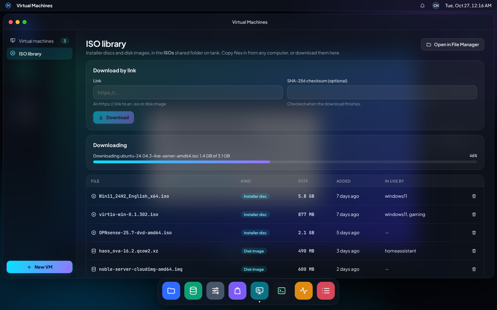

## A VM's page

Click a VM. **Overview** shows live CPU and memory, disk use and its
address; **Start**, **Restart**, **Shut down** (asks the system to shut
down, like pressing the power button) and the square **Turn off** button
(like pulling the plug) are at the top.

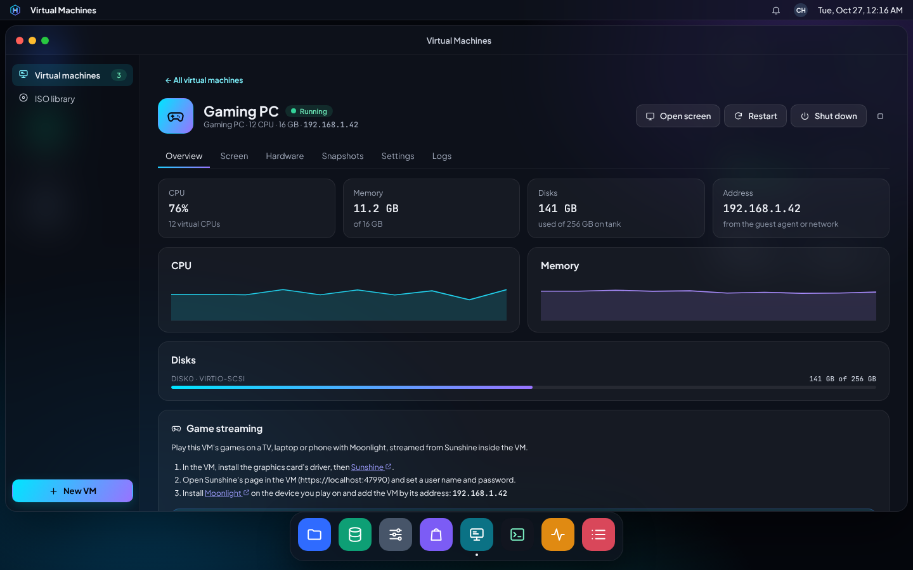

### The screen

**Open screen** shows the VM's screen in its own desktop window, with
keyboard and mouse. The toolbar sends **Ctrl+Alt+Del**, **types text** into
the VM for you (handy for passwords), opens the **Clipboard** (what was
copied in the VM, and text to paste into it), switches between
fit-to-window and actual size, turns the VM's **sound** on and off, and goes
**full screen** (in Chrome and Edge, Esc and the Windows key then go to
the VM too). Clipboard and sound are turned on per VM in **Hardware ›
Screen** (the clipboard is on by default for desktops only); the clipboard
needs spice-vdagent in Linux guests or the VirtIO guest tools in Windows,
and everyone with the VM's screen open shares it. Only administrators can open a VM's screen, and
every time it's opened is logged. The screen closes within 15 seconds when
you sign out, or when your account stops being an administrator's.

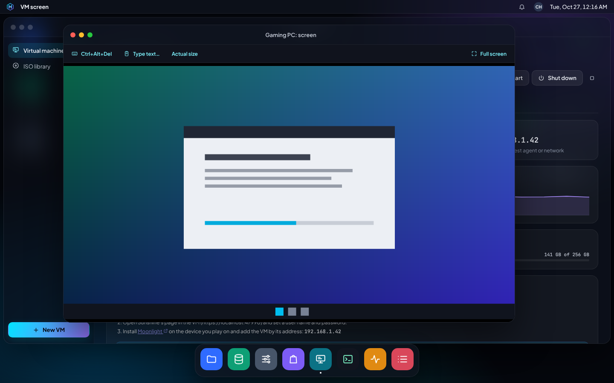

### Hardware

CPU, memory, disks (grow, add, remove), CD/DVD drives, network cards,
sound and clipboard, and devices. Changes to a running VM apply when it
next starts (the page and the list say *restart*); disks can grow while it
runs but shrink never.

While a VM runs, **Plug in a USB device now** gives it a USB stick, a
Zigbee dongle or a security key straight away (by its vendor:product ID),
and **unplug** takes it back. *Also at the next start* keeps it in the
VM's devices. Devices the server needs (its boot stick, a pool's disks)
aren't offered. To give a VM a whole USB controller (every port on it), add
the controller as a PCI device in **Devices**; the device list says which
controller each USB device is on. A device a program on the server is
using (the UPS monitor, an app's Zigbee stick) is refused until that stops,
and a keyboard or mouse only goes when you confirm (the server's own console
loses it).
Removing a disk deletes it and its snapshots, so the VM must be off and
you type its name to save. A VLAN card's VM starts only once its port is
on its VLAN (checked); if the VLAN can't be set, the VM is turned off
again and says why.

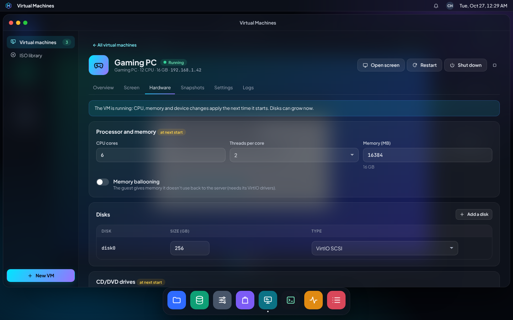

### Snapshots

A snapshot keeps the whole VM as it is: every disk, its settings, its
firmware variables and its TPM. Take one before an update; **Go back**
puts everything back (the VM must be off, and you type its name).
Deleting a snapshot asks for the name too. Snapshots count toward the
VM's space on the pool: if a VM with many snapshots rewrites a lot, it
pauses when it reaches its limit; delete old snapshots or grow a disk. Snapshots
of a running VM freeze the guest's files for a moment when the guest agent
runs; without it the snapshot is like pulling the plug (fine for most
systems; the list marks it *crash-consistent*).

**Automatic snapshots**: say how many hourly, daily, weekly and monthly
snapshots to keep (hourly on the hour, daily at midnight UTC, weekly on
Mondays, monthly on the 1st). HardyOS takes them and deletes the oldest of
each kind beyond its count; snapshots you take yourself are never deleted
by the schedule. Lowering a count (or setting a kind to 0) so that existing
automatic snapshots would go asks you to type the VM's name; turning the
whole schedule off keeps the ones there are. A VM busy with something long
(an import, a copy) waits for its snapshot without holding up the other
VMs; if it waits a while, the Snapshots tab says the snapshots are late.

VMs are included in **cloud backups** and **replication** (Backup app)
the same way: consistent with the guest agent, crash-consistent without
it, and the Snapshots tab says which applies.

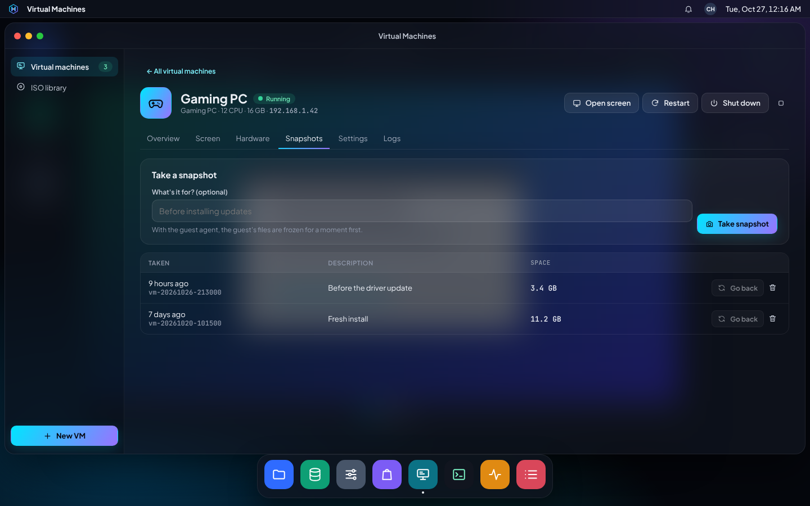

### Settings

Name and notes, **Start with the server** (with an order: 0 starts first,
like a router or DNS server, and a wait before the next VM), boot order,
firmware, the guest agent, and **Delete** (the VM must be off; you can keep
its disks, listed under *Disks kept from deleted VMs* until you delete
them).

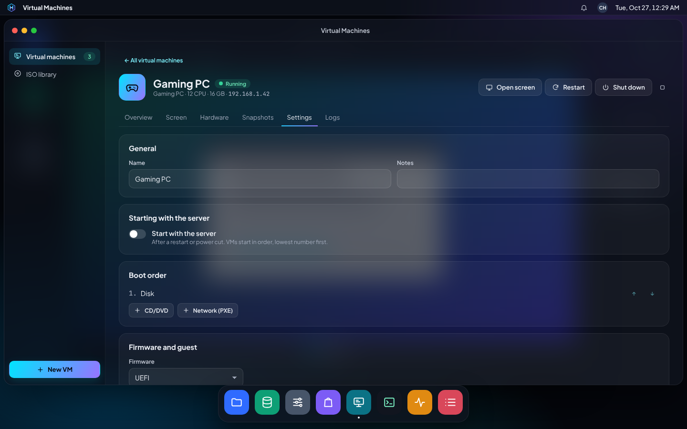

### Logs

The end of QEMU's log for the VM, for when something won't start.

## Game streaming

A gaming VM with its own graphics card is played with **Moonlight** (phones,
TVs, laptops, Steam Deck), streamed from **Sunshine** inside the VM.

### Setting it up

Make the VM from the **Gaming PC** template with **Install by itself** on;
**Set up game streaming** is on too. Pick your graphics card in the Devices
step and keep the VM's network card on the **Home network** (address spoofing
off). While Windows installs, HardyOS also installs, at the first sign-in:

- **Sunshine** (LizardByte's official Windows installer, a version HardyOS
  pins), set up with an account HardyOS makes, its web page answering the
  home network only, and UPnP off (nothing is opened on your router);
- a **virtual display** (the open-source Virtual Display Driver), so the VM
  has a screen to stream without a monitor or a dummy HDMI plug.

Both are downloaded by HardyOS (not inside Windows), checked against the
checksums HardyOS ships, and handed to Windows on a small read-only disc that
is deleted when the install is done; Windows only runs HardyOS's setup
script from it after checking the script's checksum. The log of the setup is in
`C:\ProgramData\HardyOS\streaming-setup.log` in the VM.

Then, in Windows, **install your graphics card's driver** (NVIDIA, AMD or
Intel, from their sites). HardyOS doesn't install or unlock graphics drivers:
no vGPU unlocks, no licence workarounds. Restart the VM once Windows is
installed so the card joins (see *Windows* above).

### Pairing Moonlight

Open the VM's **Overview**: the **Game streaming** card says whether Sunshine
answers. In Moonlight, pick the VM (it finds it on the home network) or add
it by the address shown. Moonlight shows a 4-digit PIN; the device appears
under **Pair a device**: click **Enter its PIN**, type it, done. Pair one
device at a time: if two are waiting, HardyOS refuses (the PIN could go to
the wrong one). Pair at home: a device that comes in through NetBird looks
to Sunshine like the server itself, so it's marked *Through NetBird* and
you have to confirm it's yours. Paired devices are listed with an
**unpair** button. Only administrators can pair or unpair, and every
pairing is logged.

Sunshine's own page answers only inside the VM (`https://localhost:47990`)
and HardyOS (a Windows Firewall rule lets in only the server's home network
address). It uses the account HardyOS made; **Show the password** asks for
your HardyOS password first (and is logged). If the server's address on the
home network changes later, the card says so: HardyOS can't reach Sunshine
until the rule `HardyOS-Sunshine-WebUI` in the VM's Windows Firewall names
the new address (or the VM is made again).

### Away from home

Turn on **Play away from home over NetBird** (remote access must be set up)
and tick the NetBird devices that may play (your phone, your laptop; none
are ticked until you choose, and NetBird's reverse proxy can't be chosen).
HardyOS then forwards Sunshine's streaming ports (TCP 47984, 47989, 48010;
UDP 47998-48000, 48002, 48010) from the server's NetBird address to the VM,
for those devices only and never from the internet; Sunshine's web page is
never forwarded. NetBird's own access policies don't limit these forwarded
ports, so the ticked list is what decides. In Moonlight away from home, add
the NetBird address the card shows. The forwarding is there only while the
VM runs and NetBird is connected, goes away when HardyOS's root helper
stops, and only one VM can be published at a time (Moonlight uses fixed
ports).

### A VM HardyOS didn't set up

For an older gaming VM the card gives the steps by hand: install the card's
driver and Sunshine, set Sunshine's account on its page, then add the VM in
Moonlight by its address.

## Good to know

- VMs start with the server in their order once their pools are mounted;
  when the server shuts down, running VMs are asked to shut down first.
- A graphics card given to a VM goes back to Docker apps whenever the VM is
  off ([GPUs and devices](gpus.md)).
- VM disks are ZFS volumes, so pool snapshots, replication and the cluster
  later can move them.
- Every VM runs confined by AppArmor. If libvirt can't confine VMs (AppArmor
  turned off), the app says VMs aren't supported and why.
- Licences: noVNC (the screen) is MPL-2.0, its licence is served at
  `/licenses/noVNC-LICENSE.txt`.
- Game streaming installs Sunshine (GPL-3.0, LizardByte) and the Virtual
  Display Driver (MIT, VirtualDrivers) inside your Windows VM, unmodified,
  from their official releases; HardyOS doesn't ship them itself.
