# Virtual machines

Run whole computers inside your HardyOS server: Windows 10 or 11, a Linux
server, a gaming PC with its own graphics card, Home Assistant, a router
(OPNsense or pfSense), TrueNAS, or anything else from an installer disc or a
disk image. Open **Virtual Machines** in the dock (administrators only).

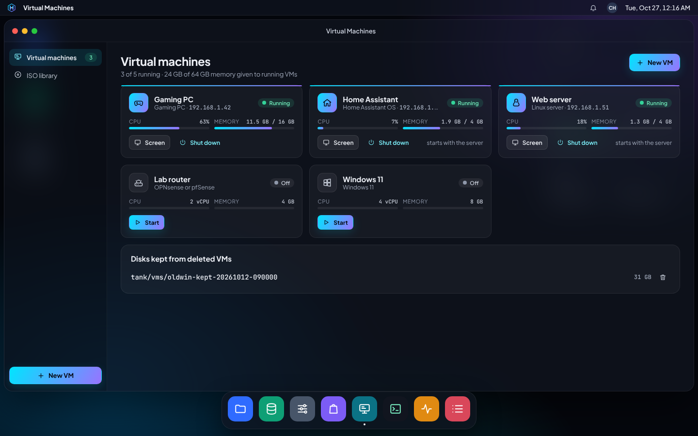

Graphics cards and other devices are covered in [GPUs and devices](gpus.md).
How it works inside: [architecture](architecture.md#virtual-machines),
decisions 120-125 and 134-143.

## Before you start

- The server's processor must have virtualization turned on (Intel VT-x or
  AMD-V, in the BIOS/UEFI setup). If it's off, the app says so.
- You need a storage pool. VM disks live on the pool you choose; a pool on
  SSDs makes VMs feel much quicker.

## Making a VM

Click **New VM**. Seven short steps, with sensible choices already made:

1. **Template**: what you want to run. Each template sets the right
   firmware, disk and network types, and drivers.

   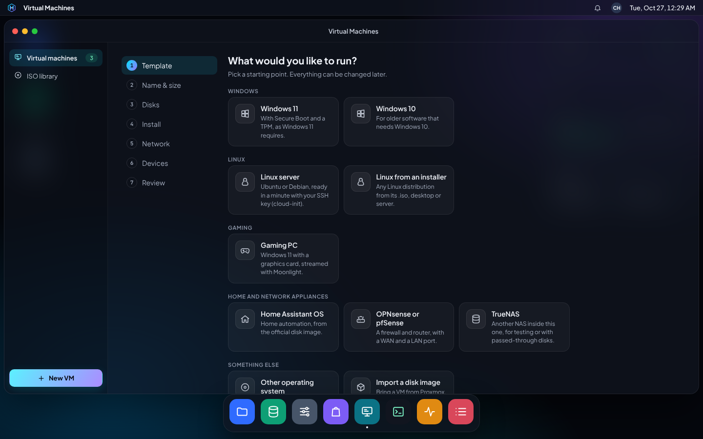

2. **Name & size**: a name, then Light, Standard or Power (or set the CPU
   cores and memory yourself). The app warns when running VMs would want
   more memory than the server has. *Show advanced settings* has firmware
   (UEFI or BIOS), Secure Boot, TPM and threads per core.

   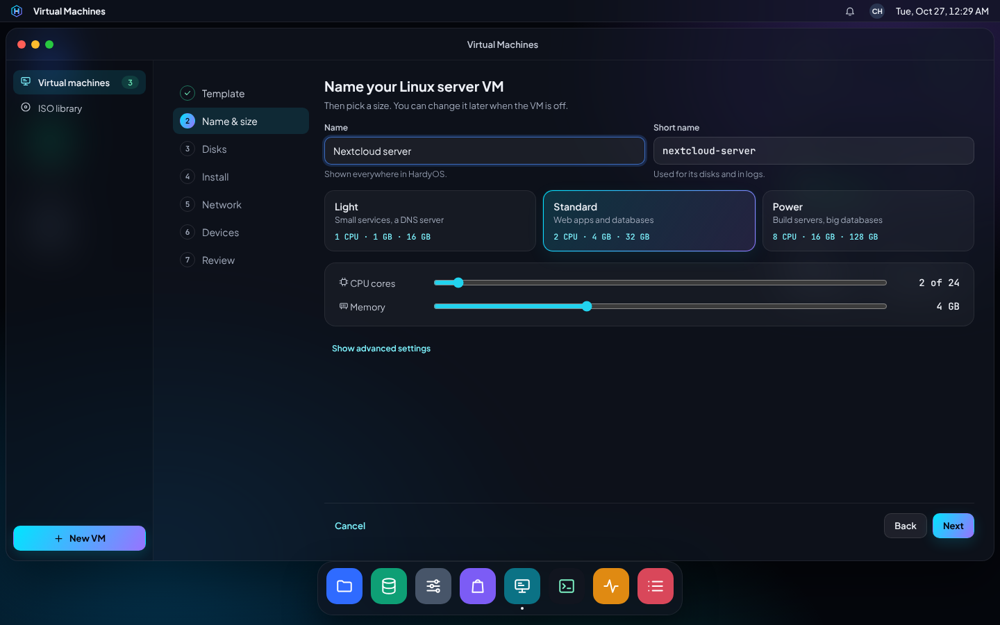

3. **Disks**: the pool, and the disks' sizes. Disks are *thin*: a 96 GB
   disk only takes the space the VM has really written. Add more disks
   here or later. The disks must fit in the pool's free space; turn on
   *Allow more than the pool has free* to make them bigger anyway. Each VM
   can use at most its disks' sizes plus a quarter (and 2 GB) on the pool,
   snapshots included, so one VM can't fill the pool for everything else.
4. **Install**: the installer disc, or for Home Assistant, cloud images and
   imports, the disk image. Pick it from the **ISO library** or paste a
   download link (with its SHA-256 checksum if the download page gives one).
   Linux cloud images ask for a user name and an SSH key and/or a password:
   the VM is ready to sign in to over SSH a minute after it starts.

   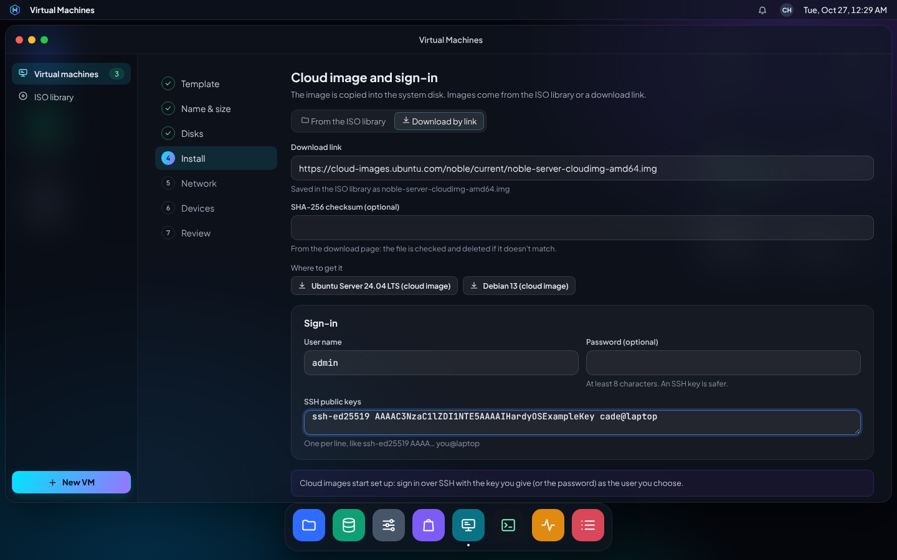

5. **Network**: **Home network** (recommended: the VM gets its own address
   from your router, like any computer), **Private (NAT)** (it reaches the
   internet through the server but nothing can reach it), or a **VLAN**.
   Routers get two network cards (WAN and LAN).

   On the home network and VLANs, a card may only use its own MAC address
   and the IP address it got, so a VM can't pretend to be the router or
   another computer. Routers and firewalls (OPNsense, pfSense) forward
   other computers' traffic and need **Allow address spoofing** on (the
   router template turns it on). Cards with the filter use IPv4 only on
   the home network. VMs on **Private (NAT)** can reach the internet and
   ask the server for an address and names (DHCP, DNS), but nothing else
   on the server itself (not its web desktop, SSH or shared folders).

   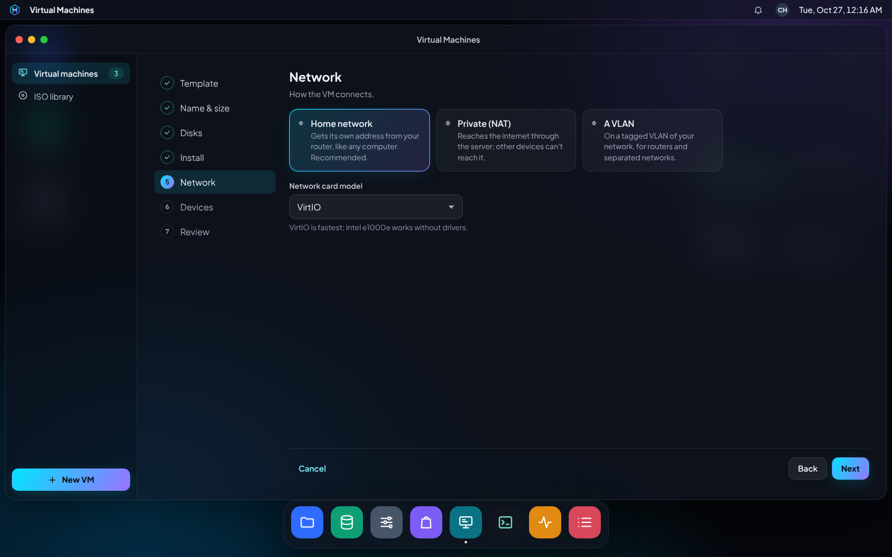

6. **Devices**: a graphics card, USB devices (a Zigbee stick for Home
   Assistant) or other PCI devices; see [GPUs and devices](gpus.md).
7. **Review**: check, choose whether it starts now and whether it starts
   with the server, and **Create VM**. Downloads, the network bridge, the
   drivers disc and copying a disk image all happen in the creation job;
   you can close the window while it runs.

### The first VM on your home network

VMs join your home network through a *bridge* (`br0`), a virtual switch
over the server's network port. The first VM that needs it creates it: the
server's network restarts for a few seconds and keeps its address (the
bridge takes over the port's address and MAC address). HardyOS then checks
that the server still has its address and the router answers; if not, it
puts the old settings back by itself and the VM isn't created (use NAT, or
set up the bridge in Control Panel > Network). If the server runs the
domain controller, it moves onto the bridge too. The bridge shows up in
Control Panel > Network, where its address can be changed or the bridge
removed (VMs on it then lose their network).

### Windows

Get the Windows installer (.iso) from Microsoft's download page and copy it
into the ISOs shared folder (or paste a download link). Windows templates
use fast VirtIO disks, so:

1. When Setup asks where to install and shows no disk, click **Load
   driver**, open the **VirtIO drivers disc** (attached for you) and pick
   the `vioscsi` folder for your Windows version.
2. After Windows starts, run `virtio-win-guest-tools.exe` from the same
   disc: network, display, memory and the guest agent.

Windows 11 gets Secure Boot and a TPM 2.0. If an installer can't see the
disk at all, change the disk type to SATA in **Hardware**.

### Linux servers (cloud images)

The Linux server template downloads Ubuntu's or Debian's cloud image,
copies it into the disk (growing the disk if the image is bigger) and sets
it up with cloud-init: your user (with sudo), your SSH keys, the password if
you gave one, the host name, and the QEMU guest agent. Sign in with
`ssh <user>@<the VM's address>`; the address shows on the VM's page once
the guest agent runs.

### Home Assistant, OPNsense, TrueNAS, imports

- **Home Assistant OS**: the official `.qcow2.xz` image is downloaded and
  unpacked into the disk. Home Assistant opens at
  `http://<the VM's address>:8123` a few minutes after the first start.
- **OPNsense / pfSense**: get the DVD image (.iso); the VM has a WAN and a
  LAN card. Put the WAN card on its own VLAN (or pass a network port
  through) so the router sits between the internet and your network.
- **Import a disk image**: VMs from Proxmox, VirtualBox, VMware or Hyper-V
  (qcow2, vmdk, vdi, vhdx, raw). Copy the image into the ISOs folder first.
  Images that need other files (backing files, split VMDKs, VMDK
  descriptor files) are refused: export them as one file. HardyOS first
  copies the image into the VM's own folder (so the pool needs room for
  the image twice while it's imported), then converts that copy as an
  unprivileged user with no network, so a crafted image can't make it read
  other files.

## The ISO library

Installer discs and disk images live in the **ISOs** shared folder, made on
the pool you choose the first time you download one. Copy files in from
any computer over the network (`\\<server>\ISOs`, administrators) or with
the File Manager, or download them here by link (https only; files from
the server's own network aren't downloaded). Files a VM has in a drive
can't be deleted. VMs don't use discs from the ISOs folder while it's
shared over NFS; turn NFS off for it. If a disc is replaced (or turned
into a link) while a VM starts, the start stops: start it again.

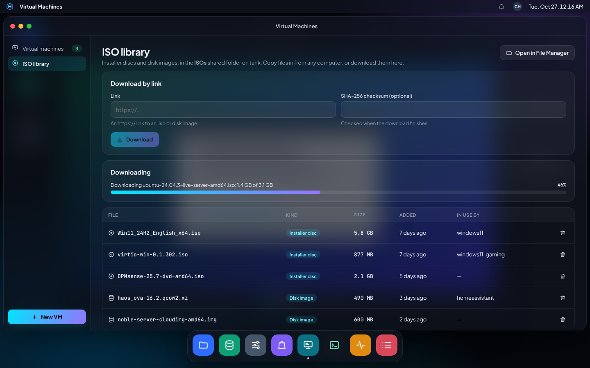

## A VM's page

Click a VM. **Overview** shows live CPU and memory, disk use and its
address; **Start**, **Restart**, **Shut down** (asks the system to shut
down, like pressing the power button) and the square **Turn off** button
(like pulling the plug) are at the top.

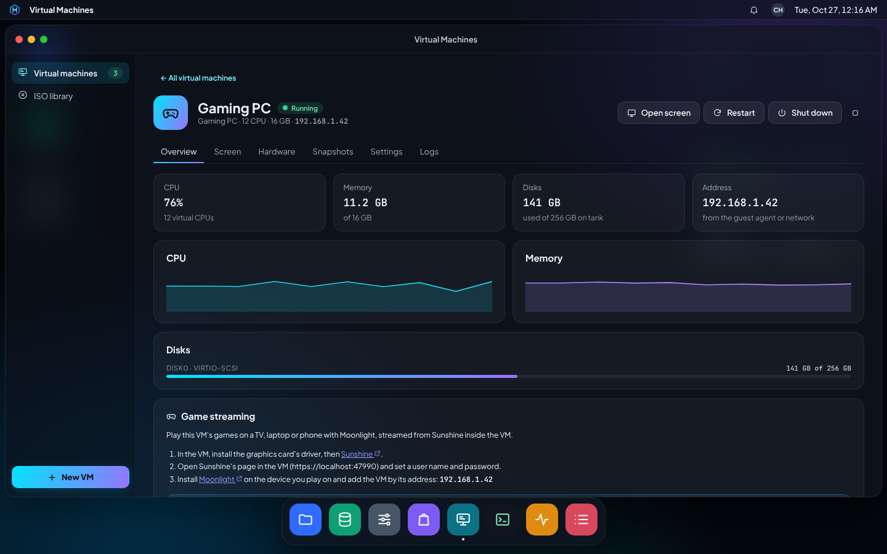

### The screen

**Open screen** shows the VM's screen in its own desktop window, with
keyboard and mouse. The toolbar sends **Ctrl+Alt+Del**, **types text** into
the VM for you (handy for passwords), switches between fit-to-window and
actual size, and goes full screen. Only administrators can open a VM's
screen, and every time it's opened is logged. The screen closes within
15 seconds when you sign out, or when your account stops being an
administrator's.

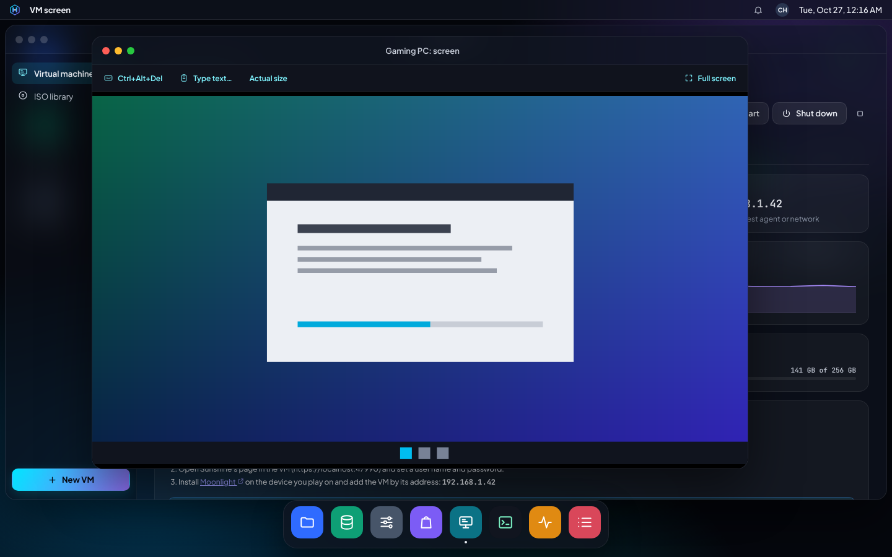

### Hardware

CPU, memory, disks (grow, add, remove), CD/DVD drives, network cards and
devices. Changes to a running VM apply when it next starts (the page and
the list say *restart*); disks can grow while it runs but shrink never.
Removing a disk deletes it and its snapshots, so the VM must be off and
you type its name to save. A VLAN card's VM starts only once its port is
on its VLAN (checked); if the VLAN can't be set, the VM is turned off
again and says why.

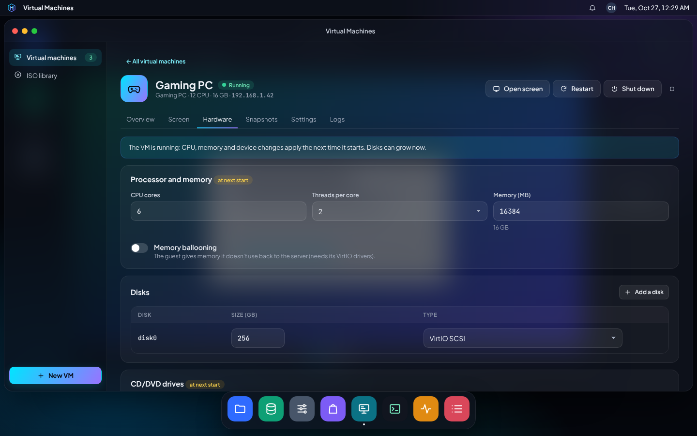

### Snapshots

A snapshot keeps the whole VM as it is: every disk, its settings, its
firmware variables and its TPM. Take one before an update; **Go back**
puts everything back (the VM must be off, and you type its name).
Deleting a snapshot asks for the name too. Snapshots count toward the
VM's space on the pool: if a VM with many snapshots rewrites a lot, it
pauses when it reaches its limit; delete old snapshots or grow a disk. Snapshots
of a running VM freeze the guest's files for a moment when the guest agent
runs; without it the snapshot is like pulling the plug (fine for most
systems; the list marks it).

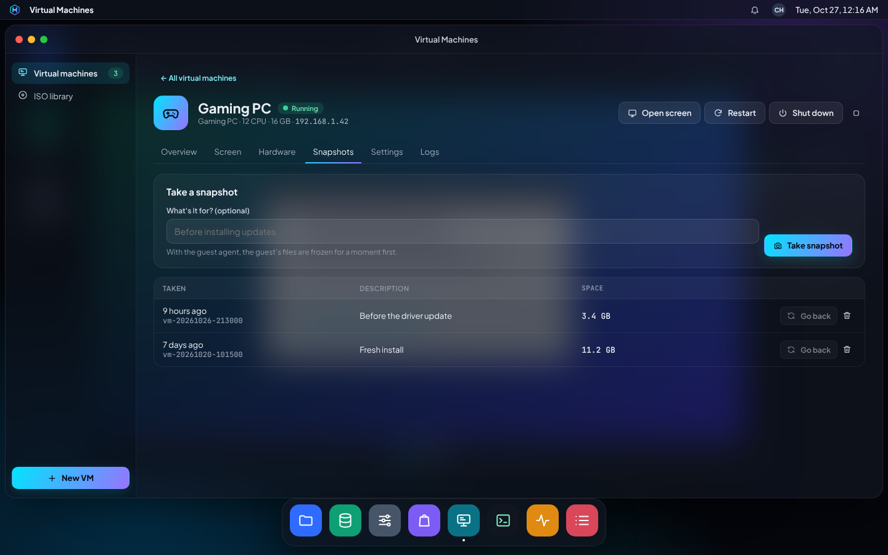

### Settings

Name and notes, **Start with the server** (with an order: 0 starts first,
like a router or DNS server, and a wait before the next VM), boot order,
firmware, the guest agent, and **Delete** (the VM must be off; you can keep
its disks, listed under *Disks kept from deleted VMs* until you delete
them).

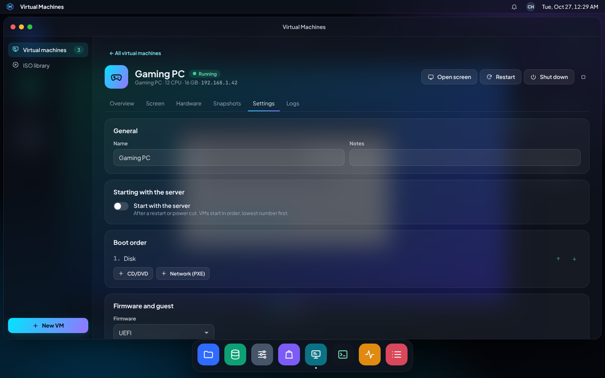

### Logs

The end of QEMU's log for the VM, for when something won't start.

## Game streaming

A gaming VM with its own graphics card is played with **Moonlight**
(phones, TVs, laptops), streaming from **Sunshine** inside the VM. The
Game streaming card on the VM's overview walks through it: install the
card's driver and Sunshine in the VM, set Sunshine's user, then add the VM
in Moonlight by the address shown. Playing away from home goes through
HardyOS's VPN once remote access is set up.

## Good to know

- VMs start with the server in their order once their pools are mounted;
  when the server shuts down, running VMs are asked to shut down first.
- A graphics card given to a VM goes back to Docker apps whenever the VM is
  off ([GPUs and devices](gpus.md)).
- VM disks are ZFS volumes, so pool snapshots, replication and the cluster
  later can move them.
- Every VM runs confined by AppArmor. If libvirt can't confine VMs (AppArmor
  turned off), the app says VMs aren't supported and why.
- Licences: noVNC (the screen) is MPL-2.0, its licence is served at
  `/licenses/noVNC-LICENSE.txt`.
